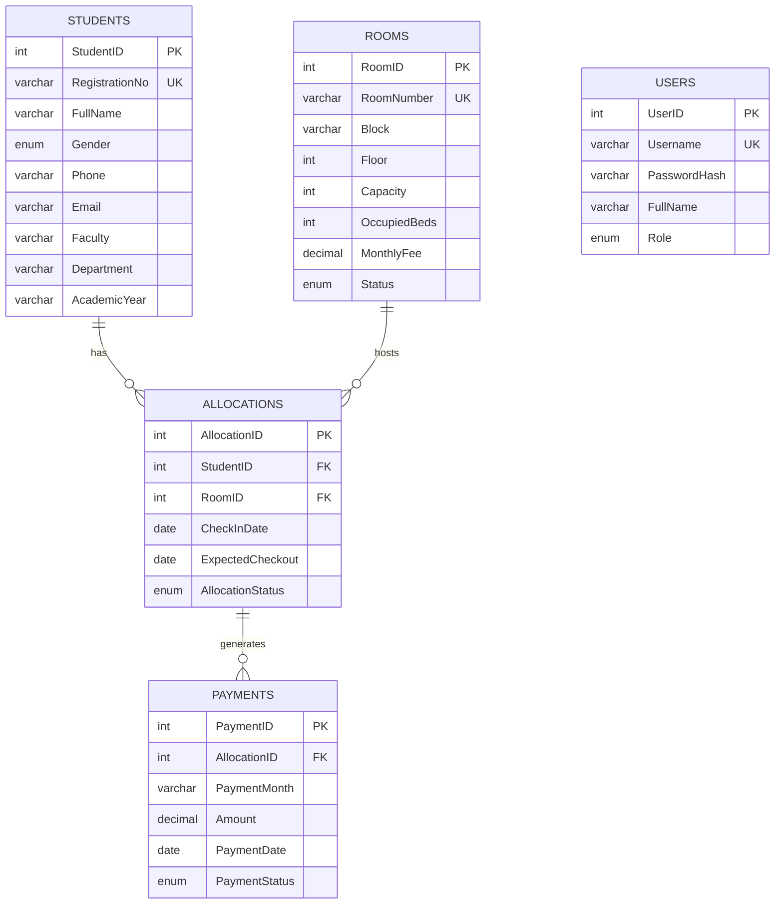

# Entity-Relationship Diagram

## Relationship Summary

- **One Student → Many Allocations** (a student may have multiple allocation records over time — e.g. after a transfer or a re-checkin the following year — but only one *Active* allocation at once, enforced at the application layer).
- **One Room → Many Allocations** (a room can house multiple students over time, and multiple beds concurrently up to its `Capacity`).
- **One Allocation → Many Payments** (a single room allocation accumulates one payment record per month).
- **USERS** is an independent entity used solely for admin authentication and does not participate in the hostel data model's relationships.
